# NEXO CLUB

NEXO CLUB es una aplicación web instalable para administrar clubes deportivos. Reúne deportistas, disciplinas, inscripciones, recaudos, comprobantes, medios de pago, equipo y auditoría. Cada operación del club se realiza en el club activo que valida Laravel.

[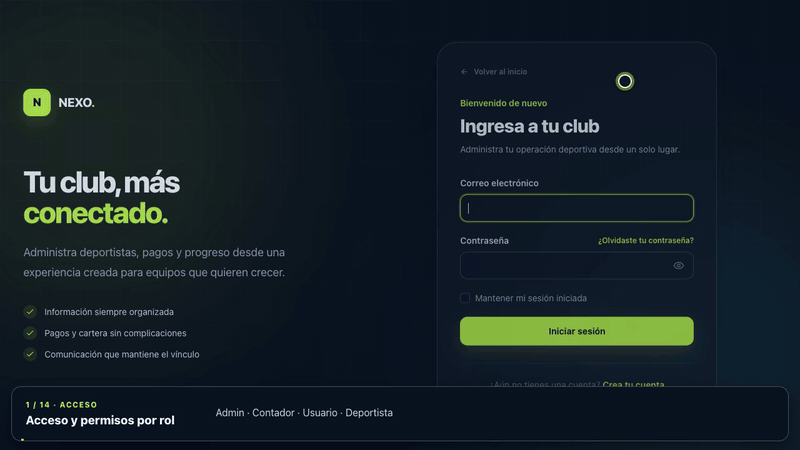](public/flow-videos/nexo-flujos.mp4)

## Flujos por rol

| Rol | Recorrido habitual |
| --- | --- |
| **Superadmin** | Entra a `/platform`, revisa las solicitudes de alta, administra clubes y asigna sus administradores. Consulta la auditoría global y las guías exclusivas de Plataforma. |
| **Admin** | Selecciona el club, configura sus datos y medios de pago, crea disciplinas, registra deportistas y gestiona inscripciones. Registra pagos, revisa comprobantes, consulta la campana y administra el equipo operativo. |
| **Contador** | Consulta el resumen financiero del club, revisa los cargos en **Recaudos** y tramita pagos y comprobantes según sus permisos. |
| **Usuario** | Consulta el resumen y las áreas operativas que autoriza su rol en el club activo. |
| **Deportista** | Entra a **Mi portal** (`/mi-dashboard`), actualiza sus datos personales y revisa sus inscripciones. En **Mis pagos** (`/mis-pagos`) consulta sus cargos y puede enviar un comprobante cuando tiene acceso al portal. |

La solicitud pública de un club se inicia en **Registro**. El solicitante verifica su correo y el superadmin puede aprobar o rechazar la solicitud. La aprobación crea el club y habilita a su administrador. Para los permisos exactos, consulta los [roles y permisos](docs/roles-and-permissions.md).

## Inscripciones, recaudos y acceso

1. En **Deportistas**, el administrador crea un perfil permanente. Si registra un correo, el sistema puede vincular una cuenta de deportista. El alta guiada permite asociar una inscripción y crear el primer cargo.
2. La inscripción comienza **Pendiente** y admite periodicidad mensual, quincenal, trimestral, semestral o anual. El importe corresponde al período seleccionado.
3. Registrar el primer pago o aprobar el primer comprobante de una inscripción pendiente fija el inicio del período pagado en la fecha de registro o aprobación. El pago puede activar una inscripción pendiente o reactivar una suspendida. El portal requiere una cuenta y un deportista activos, una inscripción activa y un cargo pagado cuyo período esté vigente.
4. En **Recaudos** (`/mensualidades`), el club consulta la vigencia y el vencimiento de cada cargo, registra pagos recibidos y aprueba o rechaza comprobantes. Si rechaza uno, registra el motivo para que el deportista pueda corregirlo cuando tenga acceso a **Mis pagos**.
5. Para las inscripciones activas, el corte genera el siguiente cargo cuando empieza el nuevo período. Toma como inicio el día siguiente al fin del último período y aplica el día de vencimiento configurado. Editar la inscripción conserva las fechas de los cargos existentes.

Por ejemplo, si un período pagado termina el **16 de noviembre**, el siguiente cargo se genera el **17** y vence el **18** si ese es el día configurado. Si el cargo sigue impago, el corte del **19** suspende la inscripción. Una inscripción suspendida queda fuera de la generación automática. Consulta los [ejemplos de cambios de fecha y cobros existentes](docs/billing-rules.md#cambios-de-fecha-y-cobros-existentes).

## Notificaciones y tareas programadas

Los horarios usan `America/Bogota`.

| Hora o evento | Resultado |
| --- | --- |
| **00:10** | `billing:generate-monthly-charges` crea los cargos que correspondan y suspende las inscripciones activas con un cargo vencido e impago. |
| **08:00** | `billing:send-notifications` recuerda al deportista el vencimiento de mañana o de hoy si el cargo ya existe, está impago y la inscripción está activa. También envía al administrador el reporte de pendientes de inscripciones activas. |
| **Cinco días después de la suspensión** | El job de las 08:00 envía el aviso al deportista y a los administradores activos del club si la inscripción sigue suspendida y el aviso está pendiente. |
| **Al registrar o aprobar un pago** | Si el pago reactiva la inscripción, el sistema intenta enviar el correo de reactivación al deportista. |

La **campana del administrador** muestra los cargos pendientes y vencidos del club activo, incluidos los de inscripciones suspendidas. El **reporte por correo** incluye una lista de cobros, enlaces a WhatsApp cuando hay un teléfono válido y un adjunto Excel `.xlsx`. Los envíos requieren que `NEXO_NOTIFICATIONS_ENABLED=true` y el transporte de correo esté configurado.

Para ejecutar ambos procesos manualmente con la fecha del servidor:

```bash
php artisan billing:generate-monthly-charges
php artisan billing:send-notifications
```

El generador imprime cuántos cargos creó y cuántas inscripciones suspendió. El comando de avisos lista los destinatarios procesados. Para probar el aviso del día, verifica en **Recaudos** que el cargo esté pendiente, que la fecha **Vence** corresponda al día evaluado y que la inscripción esté activa. Ambos comandos abarcan los registros elegibles de la base conectada. Usa `--date=YYYY-MM-DD` para otras fechas en una base aislada y `MAIL_MAILER=log` para revisar los mensajes localmente sin SMTP. Consulta la [configuración de correo y del scheduler](docs/production-setup.md#6-configurar-correo-electrónico).

## Guías y videos

Abre **Flujos** (`/documentacion-flujos`) con una sesión autenticada y usa los filtros por módulo o rol. Las guías exclusivas de Superadmin están en **Plataforma → Documentación** (`/platform/documentacion-flujos`), con videos servidos por una ruta protegida. El catálogo contiene el [recorrido general](public/flow-videos/nexo-flujos.mp4) y las 16 guías siguientes.

| Guía | Roles | Video |
| --- | --- | --- |
| Acceso y permisos por rol | Admin, Contador, Usuario, Deportista | [Acceso](public/flow-videos/acceso-roles.mp4) |
| Iniciar sesión como Superadmin | Superadmin | En Plataforma |
| Consultar el resumen del club | Admin, Contador, Usuario | [Resumen](public/flow-videos/resumen-club.mp4) |
| Administrar clubes desde Plataforma | Superadmin | En Plataforma |
| Configurar el club y sus medios de pago | Admin, Contador, Usuario | [Configuración](public/flow-videos/club-configuracion.mp4) |
| Crear y administrar disciplinas | Admin, Contador, Usuario | [Disciplinas](public/flow-videos/disciplinas.mp4) |
| Registrar un deportista | Admin | [Deportistas](public/flow-videos/deportistas-perfil.mp4) |
| Crear y gestionar inscripciones | Admin | [Inscripciones](public/flow-videos/inscripciones.mp4) |
| Registrar pagos y revisar comprobantes | Admin, Contador | [Recaudos](public/flow-videos/mensualidades-cobros.mp4) |
| Administrar el equipo del club | Admin | [Equipo](public/flow-videos/equipo-permisos.mp4) |
| Consultar Mi portal y actualizar mis datos | Deportista | [Portal](public/flow-videos/portal-deportista.mp4) |
| Enviar un comprobante de pago | Deportista | [Comprobantes](public/flow-videos/mensualidades-comprobante.mp4) |
| Consultar la auditoría de operaciones | Superadmin | En Plataforma |
| Actualizar el perfil y la contraseña | Superadmin, Admin, Contador, Usuario, Deportista | [Perfil](public/flow-videos/perfil-cuenta.mp4) |
| Gestionar avisos de cobro desde la plataforma | Admin, Contador | [Campana y Recaudos](public/flow-videos/notificaciones-plataforma.mp4) |
| Leer los correos de facturación | Admin, Deportista | [Notificaciones por correo](public/flow-videos/notificaciones-correo.mp4) |

### Vistas previas animadas

Los GIF muestran los recorridos de Hyperframes con datos de demostración. La tabla enlaza a los videos completos disponibles en el repositorio.

<details>
<summary>Acceso y configuración del club</summary>

**Acceso y permisos por rol**

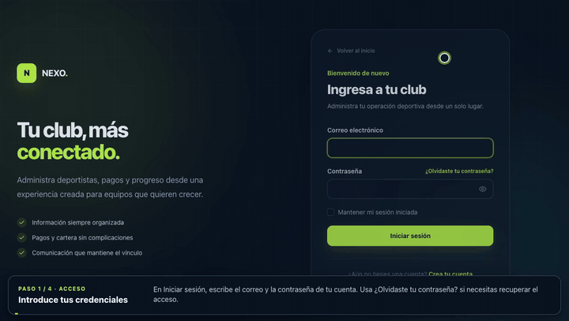

**Resumen del club**

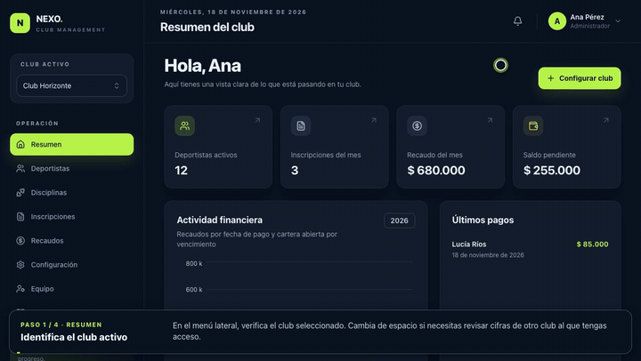

**Configuración y medios de pago**

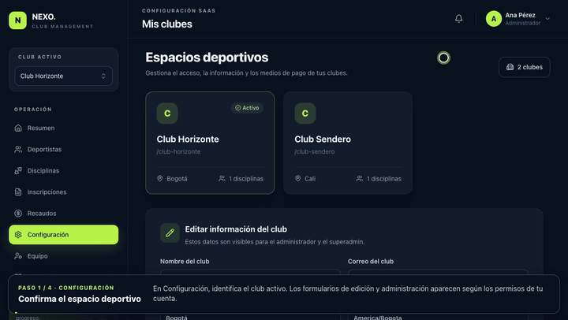

**Disciplinas**

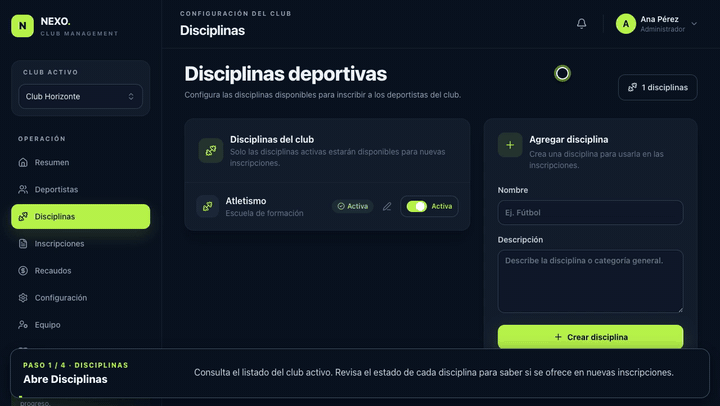

**Mi perfil**

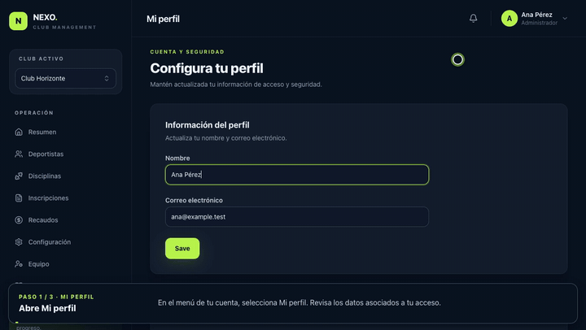

</details>

<details>
<summary>Deportistas, inscripciones y recaudos</summary>

**Alta del deportista**

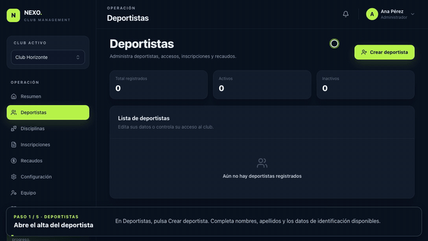

**Inscripciones**

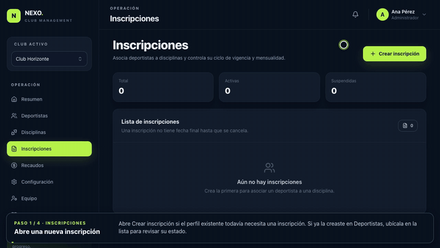

**Recaudos**

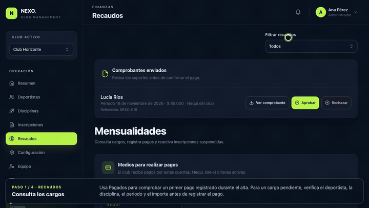

**Equipo del club**

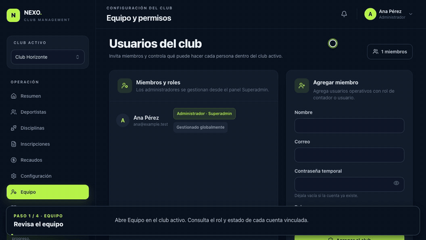

**Avisos en la plataforma**

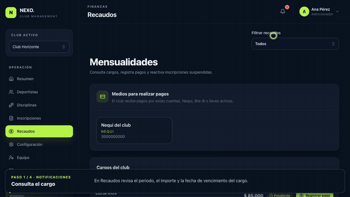

**Avisos por correo**

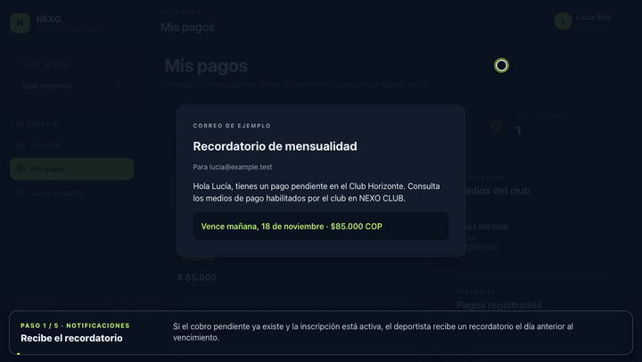

</details>

<details>
<summary>Portal del deportista</summary>

**Mi portal**

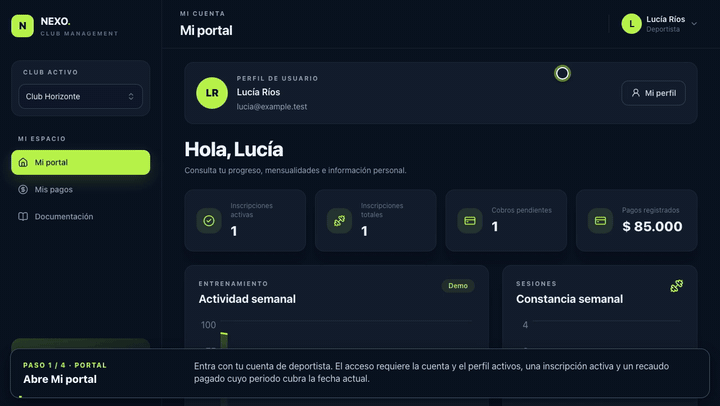

**Mis pagos y comprobantes**

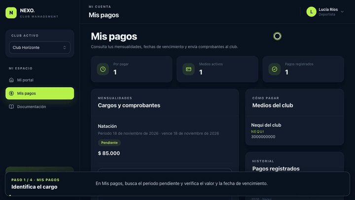

</details>

<details>
<summary>Plataforma para Superadmin</summary>

**Acceso de Superadmin**

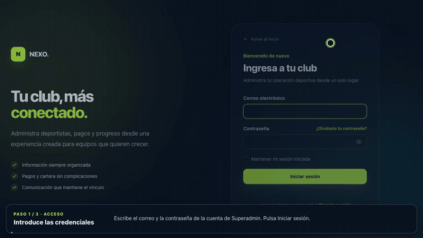

**Clubes y solicitudes**

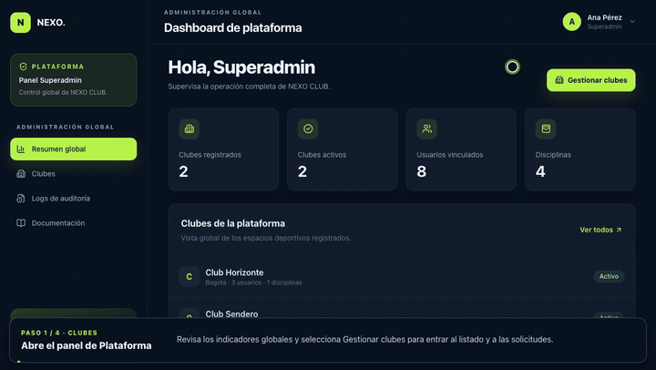

**Auditoría**

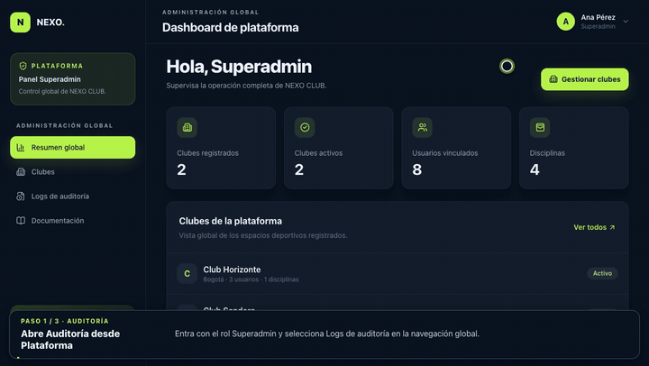

</details>

La **Visita guiada** abre pasos contextuales la primera vez que un usuario visita un módulo con recorrido y permite repetirlos desde el botón flotante. El Resumen del administrador también ofrece **Primeros pasos**, con capítulos de configuración, disciplinas, deportistas, inscripciones y recaudos.

Para regenerar las composiciones, los MP4 y sus portadas, instala FFmpeg y FFprobe y ejecuta `npm run videos:render`. Hyperframes usa Chrome para capturar las composiciones HTML. Luego ejecuta `bash scripts/render-readme-gifs.sh` para actualizar los GIF de este README desde los videos nuevos. Consulta el [catálogo audiovisual y sus fuentes](docs/flow-videos.md).

## Desarrollo local

CI usa PHP **8.2**, Composer **2** y Node.js **22**. Para el desarrollo local puedes usar SQLite o MySQL/MariaDB. Composer comprueba las extensiones de PHP, entre ellas **GD** y **ZIP** para el Excel.

En una copia nueva del repositorio, la configuración de ejemplo usa SQLite.

```bash
composer install
cp .env.example .env
php artisan key:generate
touch database/database.sqlite
php artisan migrate --seed
npm ci
composer run dev
```

La aplicación local queda en `http://localhost:8000`. Los seeders de esta instalación crean datos de demostración. Consulta los [usuarios de prueba y el contexto de desarrollo](docs/agent-context.md#roles-y-usuarios-de-prueba). Para probar la programación automática en otra terminal, ejecuta `php artisan schedule:work`.

```bash
composer test
npm run build
composer check-platform-reqs
```

## Producción y desplegables

El servidor usa MySQL/MariaDB, mantiene su propio `.env` y almacenamiento y sirve Laravel desde `public/`. Aplica las migraciones del release en el servidor y usa los seeders de permisos y superadmin para una instalación inicial. El cron del servidor debe ejecutar `php artisan schedule:run` cada minuto para que Laravel dispare los jobs a las horas configuradas. La [guía de producción](docs/production-setup.md) detalla los pasos, los seeders autorizados y SMTP.

GitHub Actions ejecuta [CI](.github/workflows/ci.yml) en los pushes y pull requests. Después de un CI correcto sobre `main`, el workflow [Release NEXO CLUB](.github/workflows/deploy-hostinger.yml) empaqueta la aplicación y crea un tag y release `deploy-<commit>`. La publicación en Hostinger y las migraciones remotas se realizan por separado.

## Referencia del repositorio

| Documento | Contenido |
| --- | --- |
| [Arquitectura](docs/architecture.md) | Módulos, aislamiento por club, modelo financiero y tareas programadas. |
| [Esquema de base de datos](docs/database-schema.md) | Tablas, relaciones y estados de la primera entrega. Las migraciones contienen la definición vigente. |
| [Roles y permisos](docs/roles-and-permissions.md) | Capacidades por rol, permisos de club y regularización de accesos. |
| [Matriz de permisos de la primera entrega](docs/permissions-matrix.md) | Referencia histórica de los permisos iniciales. |
| [Reglas de cobro](docs/billing-rules.md) | Períodos, vencimiento, suspensión, reactivación y avisos. |
| [Configuración de producción](docs/production-setup.md) | Entorno, migraciones, seeders, releases, correo y cron. |
| [Documentación visual](docs/flow-videos.md) | Catálogo de videos y proceso de render. |
| [Registro de avances](docs/progress.md) | Entregas, verificaciones y trabajo pendiente. |
| [Contexto para colaboradores](docs/agent-context.md) y [convenciones](AGENTS.md) | Estructura del proyecto, comandos y criterios para mantenerlo. |
| [Contexto compartible](skills/nexo-club-context/SKILL.md) y [guías por módulo](skills/nexo-club-guided-tours/SKILL.md) | Incorporación al repositorio y mantenimiento de las visitas guiadas. |
